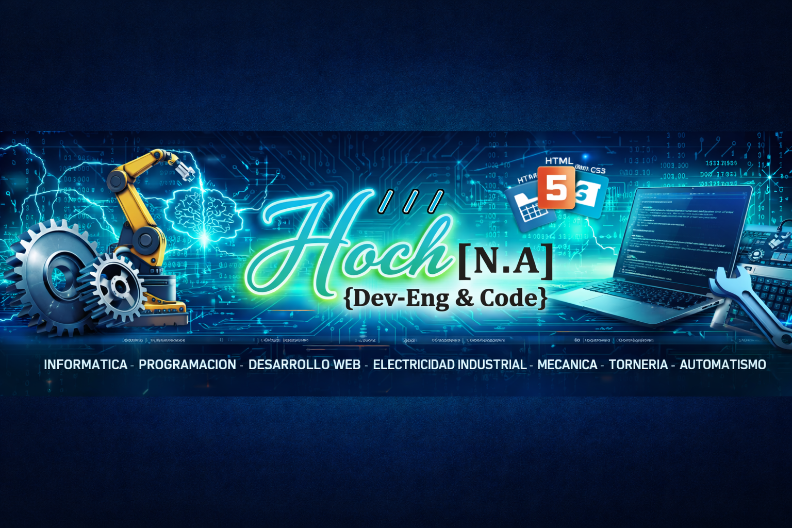

  

# ¡Hola! Soy Nahuel Hochnadel 👋

### **Desarrollador Web Fullstack & Técnico Electromecánico**
*Entusiasta por la tecnología, la lógica de programación y el desarrollo de software eficiente.*

---

### 🛠️ Tecnologías y Herramientas

---

### 📊 Lo que he aprendido por área

| Área | Lo que puedo hacer | Herramientas |
| :--- | :--- | :--- |
| **Entorno de Trabajo** | Manejo de terminal de comandos, configuración de entorno local y ejecución de scripts. | Git Bash, VS Code, Terminal |
| **Control de Versiones** | Registro de cambios por commits, manejo de ramas, repositorios remotos y versionado con Git. | Git, GitHub |
| **Código y Lógica** | Descomposición de problemas, algoritmos en Python, manipulación del DOM y estructuración web. | Python, HTML5, CSS3, JS |
| **Bases de Datos & Web** | Consultas en SQL, integración de datos y despliegue de páginas en la nube. | SQL, GitHub Pages |

---

### 🤖 Cómo trabajo con IA (Workflow Aumentado)

Uso la inteligencia artificial como **co-piloto técnico** para optimizar tiempos y mantener buenas prácticas de código:
- **Especificaciones precisas:** Defino objetivos y alcance de cada módulo antes de solicitar sugerencias de código.
- **Revisión y pruebas:** Analizo, pruebo y adapto cada solución generada por IA para asegurar que cumple con el estándar requerido.
- **Flujo ágil:** Agilizo la búsqueda de documentación y la resolución de errores en desarrollo.

---

### 🚀 Proyectos Destacados

- 🌐 **Portfolio Web:** Mi sitio personal interactivo alojado en GitHub Pages donde muestro mis proyectos e integraciones.
- ⚡ **Sistema de Presupuestos & Control:** Desarrollo enfocado en la gestión rápida de materiales y cotizaciones técnicas.

---

### 📬 Contacto

- **Email:** angelnahuel1215@gmail.com
- **GitHub:** [Mi Perfil](https://github.com/HochNADevEngineeringCode)
